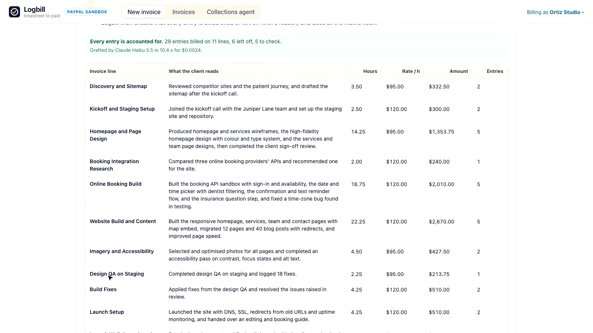
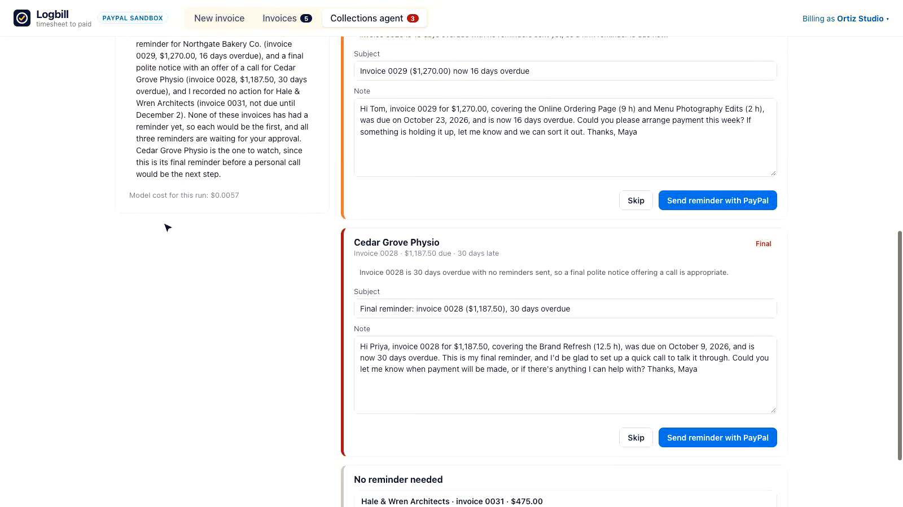
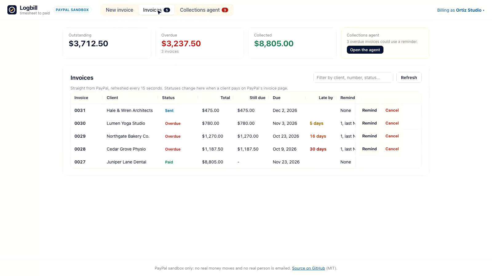

# Logbill: timesheet to paid, with PayPal

Logbill turns the hours a freelancer or small studio logged into a PayPal invoice the client understands, then chases payment with an AI collections agent.

1. **Import** a timesheet CSV from Toggl, Clockify, Harvest or a Jira worklog export (or use the sample).
2. **AI drafts the invoice lines.** Claude Haiku 5.5 groups the raw entries ("fixed nav", "call w/ team", "stuff") into a few client-ready lines, words them in plain language, and suggests what to leave off: internal admin, personal time, another client's work, learning. **The AI never touches the numbers**: Logbill computes hours, rates and money itself and checks that every entry is billed exactly once or left off with a reason.
3. **Check it in the grid.** Edit wording and rates, move any entry to another line or off the invoice, and see the totals recompute (AG Grid).
4. **Send with PayPal.** Logbill creates and sends the invoice with PayPal's Invoicing API. The client pays by PayPal, Venmo, Pay Later or card from PayPal's invoice page, or by scanning the QR code.
5. **Collect.** The invoices dashboard follows PayPal statuses live. The **collections agent**, built on **PayPal's Agent Toolkit**, reads the unpaid invoices, checks which reminders already went out, and writes each reminder in a tone that fits how late the invoice is. You approve each reminder, or turn on autopilot and the agent sends them itself, within rules it cannot break.



**Try it:** hosted demo at **https://44-212-131-104.sslip.io** (PayPal sandbox; no real money moves). **Demo video (2:51):** https://youtu.be/S4U6HEPcZtI . Devpost: https://devpost.com/software/logbill

| Collections agent (approve or autopilot) | Invoices, live from PayPal |
|---|---|
|  |  |

## Why

Getting from "hours logged" to "paid" is unpaid admin: rewriting cryptic timesheet notes into something a client will approve, deciding what is billable, then chasing late invoices without sounding rude. It is also where money leaks out: in Intuit's 2025 QuickBooks Small Business Late Payments Report, 56% of the US small businesses surveyed said they were owed money from unpaid invoices, about $17,500 on average ([Intuit QuickBooks](https://quickbooks.intuit.com/r/small-business-data/small-business-late-payments-report-2025/)).

Logbill is for the freelancers and small studios who track time but invoice by hand: it does the wording and the chasing, and leaves the numbers and the final say with them.

## How to test it (judges)

1. Open the hosted demo (or run it locally, below). Each browser gets its own workspace.
2. **New invoice** > **Use the sample timesheet** > **Draft the invoice lines with AI** (about 10 seconds). Look at what was left off and why, and the entries flagged for a second look. Try moving an entry in the **On the invoice** column.
3. **Create and send with PayPal**, then **Open it as your client sees it**.
4. Pay it on PayPal's page with the **sandbox test buyer**:
   - Email: `sb-s9ss453806293@personal.example.com`
   - Password: `i5K(1B^-`
   - Or choose **Debit or Credit Card** and use a PayPal sandbox test card such as Visa `4012 8888 8888 1881`, any future expiry, any 3-digit CVV ([PayPal's test cards](https://developer.paypal.com/tools/sandbox/card-testing/)).
5. Back in **Invoices**, the status turns to **Paid** within 15 seconds.
6. In **Invoices**, click **Add demo history** to get four older invoices (5, 16 and 30 days overdue, one not yet due), then open the **Collections agent** and click **Run the agent**. Approve or edit its reminders, or tick **Autopilot** and run it again: it sends what the rules allow and explains what it held back.

The demo only sends invoices to `example.com` addresses, the kind PayPal sandbox accounts use, so no real person is ever emailed.

## What makes it trustworthy

- **The model groups and words; the code counts.** Hours come from the timesheet and money from hours × rate, computed the way PayPal does (hours to two decimals). Whatever the model returns is repaired before you see it: unknown or repeated entries are dropped, entries it missed are placed on the closest line and flagged, lines never mix hourly rates, and entries the timesheet marks non-billable stay off. `auditDraft` then proves every entry is billed once or left off.
- **Checks that need no AI** run in code: exact duplicates (same person, day, duration and note) and days over 10 hours.
- **One correction round**: if the draft breaks a rule (say, two rates on one line), the model gets one chance to fix it, with the exact problem, before the code repairs it.
- **Agent rules enforced in code**, not just in the prompt: only unpaid invoices in your workspace, nothing before it is due (bar a heads-up two days out), at most one reminder every 3 days and 3 in total, and it can never add recipients, change amounts or cancel. When the agent breaks a rule, the tool call fails, the reason goes back to the model, and the screen shows it.
- **Workspaces**: every invoice carries the browser's workspace id as its PayPal `reference`, and the server checks it before reading, reminding or cancelling, so visitors to the shared demo only see their own invoices.

## How it uses PayPal

| Where | PayPal API or tool |
|---|---|
| Send an invoice | Invoicing v2: `POST /v2/invoicing/invoices` (items in `HOURS`, payment terms, note, `reference`), `POST .../send` |
| Pay | PayPal's hosted invoice page (PayPal, Venmo, Pay Later, cards) and `POST .../generate-qr-code` for a QR code |
| Dashboard | `POST /v2/invoicing/search-invoices` filtered by the workspace `reference`, `GET .../invoices/{id}` |
| Remind and cancel | `POST .../remind`, `POST .../cancel` |
| Collections agent | **PayPal Agent Toolkit** (`@paypal/agent-toolkit`, OpenAI tool format): `search_invoicing` and `get_invoice` to read, `send_invoice_reminder` to send, after Logbill's rules allow it |

## Tools used

- **AI**: Claude Haiku 5.5 (`anthropic/claude-haiku-5.5`) through OpenRouter's OpenAI-compatible API. Drafting uses a forced `submit_draft` tool call, so the answer is structured JSON validated with Zod, plus one correction round. The agent is a tool-calling loop over PayPal Agent Toolkit tools and three of Logbill's own (`reminder_history`, `propose_reminder`, `propose_no_action`). A typical draft costs about $0.002 and an agent run about $0.006. Any OpenAI-compatible endpoint works (`AI_BASE_URL`, `AI_MODEL`).
- **PayPal**: REST Invoicing v2 and the PayPal Agent Toolkit, in the sandbox.
- **AG Grid** (Community, v34): the timesheet grid with an in-cell select to move entries between lines, the editable invoice-lines grid (wrapping text, popup text editor, pinned totals row, live amounts with cell flash), and the invoices grid (status chips, overdue colouring, quick filter, pinned action column, tooltips, live refresh).
- **Hosting**: the demo runs on an AWS EC2 t4g.micro with Caddy for HTTPS; `deploy/ec2-user-data.sh` sets it up, with secrets read from SSM Parameter Store. A Render Blueprint (`render.yaml`) is included as an alternative.
- Built with TypeScript, React 18, Vite, Express 5, Zod, Papa Parse and Vitest.

## Run it locally

You need Node 22 or newer, a PayPal sandbox app and an OpenRouter (or other OpenAI-compatible) API key.

1. In the [PayPal Developer Dashboard](https://developer.paypal.com/dashboard/applications/sandbox), create a sandbox app, tick **Invoicing** under its features, and copy its client ID and secret. Note the sandbox business account the app belongs to (Testing Tools > Sandbox Accounts).
2. ```sh
   git clone https://github.com/vinit1009/logbill && cd logbill
   npm install
   cp .env.example .env   # fill in the values
   npm run dev            # API on :8787, web app on http://localhost:5173
   ```
   (`npm run dev` loads `.env`; or export the variables yourself.)
3. Tests: `npm test`. Production build: `npm run build && npm start` (serves the app on `PORT`, default 8787).

| Variable | What |
|---|---|
| `PAYPAL_CLIENT_ID`, `PAYPAL_CLIENT_SECRET` | The sandbox app's credentials |
| `PAYPAL_INVOICER_EMAIL` | The sandbox business account the app belongs to |
| `AI_API_KEY` | OpenRouter key (or your provider's) |
| `AI_BASE_URL`, `AI_MODEL` | Optional; default `https://openrouter.ai/api/v1` and `anthropic/claude-haiku-5.5` |
| `AI_DAILY_LIMIT` | Optional cap on AI calls per day (default 400) |
| `RECIPIENT_DOMAINS` | Optional; email domains invoices may go to (default `example.com`) |

Without `AI_API_KEY`, drafts fall back to one line per project and the agent is off.

## How it is built

```
web/ (React + AG Grid)  ──>  server/ (Express)
                                 ├─ ai.ts         drafting with tool calls + a correction round
                                 ├─ agent.ts      collections agent: PayPal Agent Toolkit tools + Logbill's rules
                                 ├─ reminders.ts  reminder log and the rules every reminder must pass
                                 └─ paypal.ts     OAuth + Invoicing v2
shared/core.ts  timesheet parsing, draft repair and audit, money, the PayPal invoice payload (used by both sides)
```

## License

[MIT](LICENSE)
